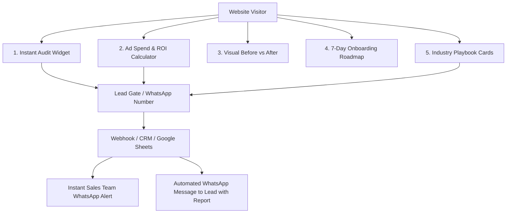
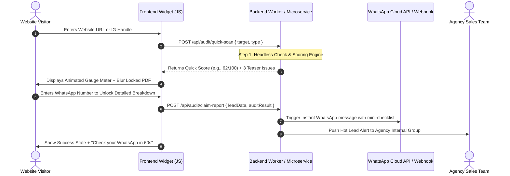
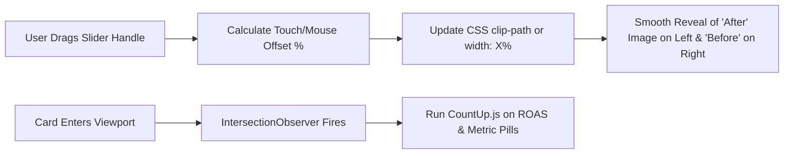
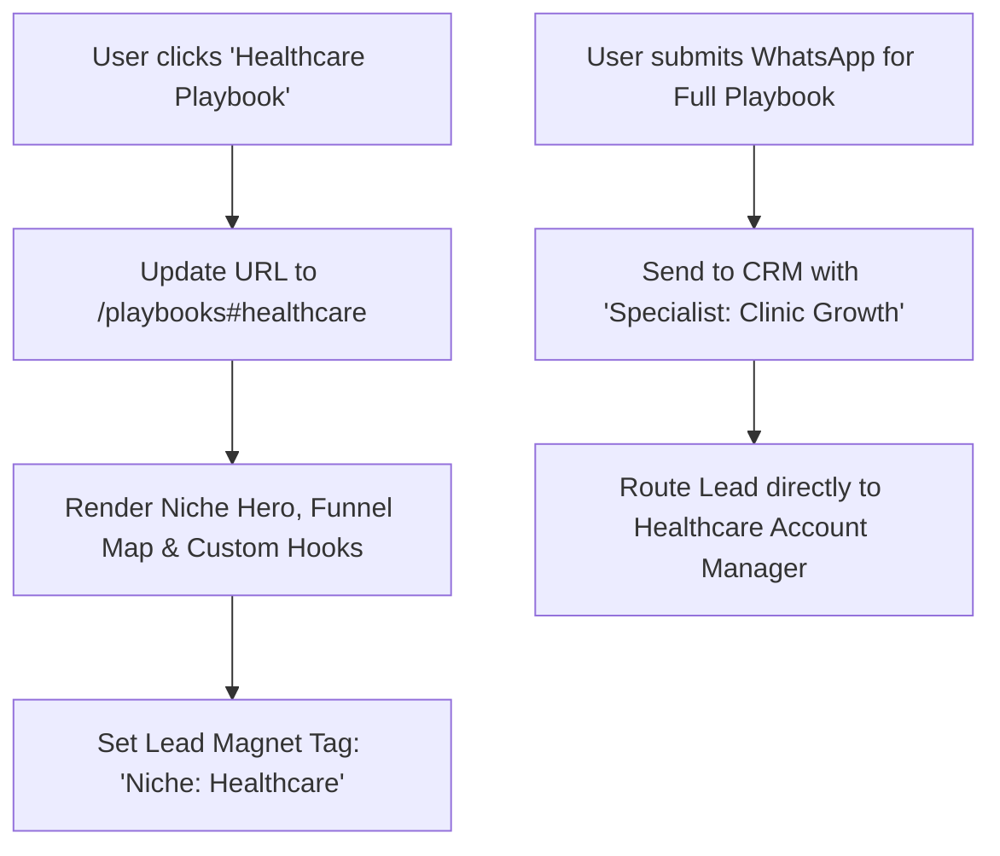

# Agency Website Growth Engine: Input, Process & Output Specification

> **Document Type:** Feature Architecture & Technical Specification  
> **Target Audience:** Frontend Developers, Backend Engineers, UI/UX Designers, Agency Founder & Sales Team  
> **Language Format:** English technical clarity with practical Tanglish implementation notes.

---

## Executive Summary & Architecture Overview

இந்த 5 interactive features-ஓட முக்கிய நோக்கம்: சாதாரண agency portfolio website-ah **High-Converting Inbound Sales Machine**-ah மாற்றுவது. 



---

## 1. Interactive Lead Magnet: "Free Instant Audit Widget"

### 1.1 Objective (நோக்கம்)
Normal contact form fill panna visitor hesitate pannuvanga. Single-input widget moolama instant curiosity generate panni, 30 seconds-la actionable value kuduthu phone/WhatsApp number capture panrathu.

### 1.2 Input Requirements

| Input Field | Type | Mandatory? | Validation Rule | Example |
| :--- | :--- | :--- | :--- | :--- |
| **Asset Type** | Radio / Toggle | Yes | `website` \| `instagram` | "Website" |
| **Audit Target** | Text Input | Yes | Valid URL format or valid IG handle format (`@...` or without `@`) | `https://myclinic.in` or `@chennaidental` |
| **WhatsApp Number** | Tel Input (Step 2 - Gate) | Yes | 10 digits Indian mobile (`^[6-9]\d{9}$`) | `9876543210` |
| **Business Name / Name** | Text Input (Step 2 - Gate) | Optional | 2 to 50 characters | `Dr. Ravi Kumar` |

### 1.3 Processing Logic (எப்படி Process ஆகணும்)



#### Detailed Step-by-Step Logic:
1. **Input Sanitization & Normalization:**
   - URL-ah protocol (`https://`) illama kudutha auto-prepend pannanum.
   - Instagram handle-la `@` irundha strip panni clean handle edukanum.
2. **Speed & Tracking Audit (Backend / Microservice):**
   - **For Website:**
     - Ping Google PageSpeed Insights API (Mobile score check).
     - Simple HTML scraper: Check if `fbq('init')` (Meta Pixel) or `gtag('config')` (Google Analytics 4) exists.
     - SSL certificate check (`https` status).
     - Meta Title & Description presence check.
   - **For Instagram (Scraper / Graph API / Rule-based Estimator):**
     - Bio link availability (link in bio irukka illaya).
     - Highlights categorization check.
     - Post frequency & Engagement rate estimation.
3. **Scoring Algorithm (Total: 100 Points):**
   - **Mobile Load Speed:** 25 Points (Under 2.5s = 25, 2.5-4s = 15, >4s = 5).
   - **Ad Tracking & Pixel Health:** 35 Points (Missing Pixel = 0, Pixel Present = 35).
   - **SEO & Social Optimization:** 25 Points (Missing OG tags / Meta = 10, Complete = 25).
   - **Call-to-Action / Mobile UX:** 15 Points.
4. **Lead Qualification Scoring:**
   - Score `< 50`: "High Urgent Need" (Hot Lead for sales).
   - Score `50 - 75`: "Growth Optimization Candidate" (Warm Lead).
   - Score `> 75`: "Scaling & Performance Candidate" (High Ticket Ad Lead).

### 1.4 Output & Presentation (எப்படி Output வரணும்)

#### A. Frontend Visitor View:
1. **State 1: Loading State (2-3 seconds animation):**
   - Animated loader with rotating progress messages:
     - *"Scanning Meta Pixel & Conversion Tracking..."*
     - *"Analyzing Mobile Loading Speed..."*
     - *"Auditing Organic Search Visibility..."*
2. **State 2: Instant Teaser Score (Before Gate):**
   - Circular SVG Gauge meter showing score: e.g., `62 / 100` with status badge: ⚠️ **Action Needed**.
   - 3 pill tags:
     - ❌ **Meta Pixel Missing** (Ad budget spend panna tracking waste aagum!)
     - ⚠️ **Mobile Speed: 4.1s** (35% visitors bounce aavanga)
     - ✅ **SSL & Basic SEO Active**
   - Locked Deep-Dive Card (Blurred preview of competitor ranking & 5-step action plan).
3. **State 3: Lead Capture Modal / Inline Form:**
   - Single field + Big CTA: *"Where should we send your 1-Page Fix Checklist?"* -> WhatsApp Number -> Button: `Get My Free Audit on WhatsApp 📲`.
4. **State 4: Confirmation State:**
   - *"Check your WhatsApp! We just sent your personalized audit report."*
   - Direct button: *"Chat with our Strategist on WhatsApp now"* (Deep link: `https://wa.me/91XXXXXXXXXX?text=Hi, I just ran audit for myclinic.in, want to fix my Meta Pixel`).

#### B. Internal Agency / Sales Output (Webhook / CRM):
- **Payload sent to Sales Telegram/WhatsApp Group & Google Sheets:**
  ```json
  {
    "lead_type": "AUDIT_WIDGET",
    "timestamp": "2026-11-02T10:45:00Z",
    "business_target": "https://myclinic.in",
    "phone": "+919876543210",
    "audit_score": 62,
    "critical_failures": ["Missing Meta Pixel", "Slow Mobile Speed (4.1s)"],
    "lead_grade": "HOT_LEAD",
    "suggested_pitch": "Mention that their competitors in Chennai are running Facebook ads with active pixels while their site loses 35% traffic to load speed."
  }
  ```

---

## 2. High-Converting ROI / Ad Spend Calculator

### 2.1 Objective (நோக்கம்)
B2B & Business owners-ku ad budget pota ethana lead varum, revenue evlo generate aagum nu confusion irukkum. Transparency kaati, interactive slider moolama live estimation kuduthu call book panna vekkuradhu.

### 2.2 Input Requirements

| Input Field | UI Component | Default Value | Options / Constraints |
| :--- | :--- | :--- | :--- |
| **Target Industry** | Segmented Tab / Dropdown | `Healthcare / Clinics` | • Healthcare / Dental / Eye Clinics<br>• Real Estate & Builders<br>• E-commerce & D2C Brands<br>• EdTech & Coaching<br>• Local B2B & Services |
| **Monthly Ad Budget (₹)** | Interactive Range Slider + Number input | `₹35,000` | Min: `₹15,000`, Max: `₹10,00,000`, Step: `₹5,000` |
| **Average Order Value / Deal Value (₹)** | Optional Toggle ("Customize Ticket Size") | Industry default (e.g., ₹2,500 for Clinic, ₹5,00,000 for Real Estate commission/sale) | Min: `₹500`, Max: `₹25,00,000` |
| **Primary Platform** | Toggle Pill | `Meta Ads (FB + IG)` | `Meta Ads` \| `Google Search Ads` \| `Omni-channel (Both)` |

### 2.3 Processing Logic & Calculation Engine

#### Industry Benchmark Matrix (Tamil Nadu / Indian Market Calibration):
| Metric | Healthcare / Clinics | Real Estate | E-Commerce | B2B / Services |
| :--- | :--- | :--- | :--- | :--- |
| **Average CPC (₹)** | ₹18 - ₹28 | ₹45 - ₹85 | ₹8 - ₹16 | ₹35 - ₹65 |
| **Landing Page Conv. %** | 6.5% - 10.0% | 2.5% - 4.5% | 1.8% - 3.2% | 4.0% - 7.5% |
| **Lead-to-Patient/Sale %** | 18% - 30% | 2.0% - 4.0% | 100% (Instant buy) | 8% - 15% |
| **Default Ticket Value (₹)** | ₹3,000 (Consult + Proc) | ₹45,00,000 (Property) | ₹1,400 (Cart) | ₹25,000 (Retainer) |

#### Mathematical Formulas (Executed live on client-side JS on every slider drag):
```javascript
// 1. Estimated Clicks
const avgCPC = industryData[industry].avgCPC;
const estClicksMin = Math.floor(adBudget / (avgCPC * 1.15));
const estClicksMax = Math.floor(adBudget / (avgCPC * 0.85));

// 2. Potential Leads / Inquiries
const convRateMin = industryData[industry].convRateMin;
const convRateMax = industryData[industry].convRateMax;
const estLeadsMin = Math.round(estClicksMin * (convRateMin / 100));
const estLeadsMax = Math.round(estClicksMax * (convRateMax / 100));

// 3. Projected Closures / Sales
const closeRate = industryData[industry].avgCloseRate / 100;
const projectedDealsMin = Math.max(1, Math.round(estLeadsMin * closeRate));
const projectedDealsMax = Math.max(2, Math.round(estLeadsMax * closeRate));

// 4. Projected Revenue & ROAS
const projectedRevenueMin = projectedDealsMin * ticketSize;
const projectedRevenueMax = projectedDealsMax * ticketSize;
const roasMin = (projectedRevenueMin / adBudget).toFixed(1);
const roasMax = (projectedRevenueMax / adBudget).toFixed(1);
```

### 2.4 Output & Presentation (எப்படி Output வரணும்)

```
+-------------------------------------------------------------------------+
|  [Select Industry: Healthcare v ]   [Monthly Ad Spend: ₹50,000 --------O] |
+-------------------------------------------------------------------------+
|                                                                         |
|   ESTIMATED CLICKS        QUALIFIED LEADS          PROJECTED REVENUE     |
|     1,800 - 2,400           120 - 180 Leads         ₹1.8L - ₹2.7L       |
|                                                    (Est. 3.6x - 5.4x)   |
|                                                                         |
|  [💡 Pro Tip: With a dedicated WhatsApp conversion funnel, CPL drops 30%]|
|                                                                         |
|  [  Get This Custom 30-Day Media Plan Blueprint (Free WhatsApp PDF)  ]  |
+-------------------------------------------------------------------------+
```

1. **Interactive Metrics Cards:**
   - 4 glassmorphic cards with animated numbers (counter roll-up on change):
     - **Estimated Targeted Traffic:** `2,100 - 2,800 visitors`
     - **Cost Per Lead (CPL):** `₹280 - ₹410`
     - **Expected Monthly Inquiries/Appointments:** `120 - 180 leads`
     - **Projected Return / Revenue:** `₹1,80,000 - ₹2,70,000` (ROAS: `3.6x - 5.4x`)
2. **Dynamic Advice Pill:**
   - Budget-ku thagundha recommendation display aaganum:
     - *If Budget < ₹25,000:* "⚠️ Meta Ads Only recommended. Google search will exhaust budget quickly."
     - *If Budget ₹25,000 - ₹1,00,000:* "🔥 Sweet Spot for Local Lead Gen (Meta + Retargeting)."
     - *If Budget > ₹1,00,000:* "🚀 Full-Funnel Scaling (Google Search Intent + Meta Lookalikes)."
3. **CTA / Conversion Hook:**
   - Primary Button: *"Lock in this 4x ROAS - Book a Strategy Call"* -> Opens Calendly or WhatsApp.
   - Secondary Button: *"Email/WhatsApp Me This Custom Plan Breakdown"* -> Opens phone capture drawer.

---

## 3. Proof of Work: "Visual Before vs After" Case Studies

### 3.1 Objective (நோக்கம்)
Plain text testimonials-ah yaarum namba maataanga. Real metrics, visual UI redesigns, and Meta Ads Manager screenshots-ah draggable slider moolama live-ah proof panni trust build panrathu.

### 3.2 Input Requirements

#### A. Content/Admin Inputs (Data feeding the component via JSON / CMS):
```json
{
  "id": "chennai-dental-care",
  "client_name": "SmileCare Multispeciality Dental",
  "industry": "Healthcare",
  "location": "Anna Nagar, Chennai",
  "duration": "60 Days Sprint",
  "before_state": {
    "screenshot_url": "/assets/case-studies/smilecare-before-ad.webp",
    "website_preview": "/assets/case-studies/smilecare-old-site.webp",
    "metrics": {
      "monthly_inquiries": 14,
      "cpl": "₹780 / lead",
      "roas": "1.1x",
      "conversion_rate": "1.2%"
    },
    "critical_pain": "Generic flyers shared on FB, no landing page, no pixel tracking."
  },
  "after_state": {
    "screenshot_url": "/assets/case-studies/smilecare-after-meta.webp",
    "website_preview": "/assets/case-studies/smilecare-new-landing.webp",
    "metrics": {
      "monthly_inquiries": 142,
      "cpl": "₹195 / lead",
      "roas": "4.8x",
      "conversion_rate": "7.8%"
    },
    "growth_multiplier": "+914% Patient Growth"
  },
  "core_actions_taken": [
    "Replaced static flyer with 3 high-hook Tamil Reel ads featuring the doctor.",
    "Built 1-click WhatsApp appointment landing page with Google Reviews widget.",
    "Integrated automated SMS reminder to stop patient no-shows."
  ]
}
```

#### B. User Interactive Inputs:
- **Category Filter Tabs:** `All`, `Healthcare`, `Real Estate`, `E-Commerce`, `D2C`.
- **Drag Slider / Hover Position:** X-axis touch/mouse coordinates (0% to 100%).
- **View Toggle:** `Metrics View` vs `Visual UI / Ad Creative View`.

### 3.3 Processing Logic (எப்படி Process ஆகணும்)



1. **Slider Drag Engine:**
   - Touch/Mouse event listener tracking relative position `X / containerWidth`.
   - Pure CSS `clip-path: inset(0 0 0 ${100 - xPercent}%)` or split container with `overflow: hidden` for 60fps mobile hardware acceleration.
2. **Metric Transition:**
   - Side-by-side comparative table with visual delta pills:
     - CPL: `₹780` ➔ `₹195` (Green badge: `🔻 75% Cheaper`).
     - Leads: `14/mo` ➔ `142/mo` (Green badge: `🚀 10x Jump`).
3. **Lazy Loading & WebP Optimization:**
   - Screenshots should be compressed WebP with responsive srcset for mobile performance.

### 3.4 Output & Presentation (எப்படி Output வரணும்)

1. **Interactive Slider UI:**
   - Center divider with a glowing draggable circular icon `◀ || ▶`.
   - Left side label: `BEFORE (Stuck at 1.1x ROAS)` in muted red badge.
   - Right side label: `AFTER (Scaled to 4.8x ROAS)` in vibrant emerald green badge.
2. **Metrics Bar below Image:**
   - 3 clean comparative stat columns:
     - **Cost Per Lead:** `₹780` ➔ `₹195`
     - **Monthly Appointments:** `14` ➔ `142`
     - **Direct Patient Revenue:** `₹84,000` ➔ `₹6,80,000`
3. **"Blueprint Breakdown" Accordion Drawer:**
   - Button: *"How did we achieve this? Read 3-Step Strategy"*
   - On click, opens modal showing the exact ad script hook, landing page layout, and ad spend budget distribution.
4. **Direct Bottom CTA:**
   - *"Want results like SmileCare for your clinic? [Get Free Strategy Session]"*

---

## 4. Interactive Client Onboarding Roadmap (7-Day Sprint)

### 4.1 Objective (நோக்கம்)
Client advance pay pannathukku appuram: "Ippo namma ennana pannanum? Eppo ads live aagum? Eppo results varum?" nu panic aavanga. 7-Day Sprint timeline visual-ah iruntha onboarding hesitation 100% poidum.

### 4.2 Input Requirements

| Input Trigger | Source | Purpose |
| :--- | :--- | :--- |
| **Active Step Selection** | User Click / Tap on Day Tabs | Highlights corresponding sprint phase |
| **Client Business Type Filter** | Optional Header Toggle (`Lead Gen` vs `E-Com Sales`) | Customizes the sprint deliverables text dynamically |
| **Milestone Status Data** | Static Config / JSON Array | Defines day ranges, tasks, deliverables, client prerequisites |

### 4.3 Processing Logic (எப்படி Process ஆகணும்)

1. **Stepper State Management:**
   - Default active step: `Day 1–2`.
   - On step click, animated line fill (SVG progress stroke) moves from previous node to clicked node.
   - 3 distinct detail sections dynamically populate without full page reload:
     - 🛠️ **What We Do (Agency Responsibility)**
     - 📥 **What We Need From You (Client Responsibility - 15 mins only)**
     - 📦 **Visible Deliverable by End of Phase**
2. **Gamified Countdown Indicator:**
   - Dynamic tag: *"From Payment to First Live Ad in 144 Hours"*.

### 4.4 Output & Presentation (எப்படி Output வரணும்)

```
===================================================================================
 7-DAY ONBOARDING SPRINT: FROM SIGN-OFF TO LIVE PROFITABLE ADS
===================================================================================
 (●) DAY 1-2 -------- (●) DAY 3-5 -------- (●) DAY 6 -------- (●) DAY 7+
   Deep Dive            Creative Engine      Pixel & Launch     Scaling & Reports
===================================================================================
```

#### Step-by-Step Interactive Accordion Content:

#### 🟢 Phase 1: Day 1–2 | Brand Deep Dive & Competitor Teardown
- **What We Do:** 
  - Audit top 3 competitors in Chennai/Tamil Nadu (Ad copies, offers, landing pages).
  - Define your Unique Value Proposition (UVP) & high-converting offer (e.g., Free Initial Scan / Site Visit Cab).
- **Client Action Required (15 Mins):**
  - Fill 8-question intake form & grant Meta Business Manager / Ad Account access.
- **Key Deliverable:** 
  - 📄 1-Page Competitor Tear-Down PDF + Finalized Offer Document.

#### 🟢 Phase 2: Day 3–5 | Creative Ad Copy, Hooks & Landing Page Wireframing
- **What We Do:**
  - Script 5 high-converting Tamil & English ad hooks (Problem-Agitate-Solve framework).
  - Design conversion-optimized mobile landing page wireframe with WhatsApp CTA.
  - Create ad banner creatives or edit raw reel clips.
- **Client Action Required (10 Mins):**
  - 1-click review & WhatsApp voice note approval for scripts.
- **Key Deliverable:**
  - 🎨 Figma landing page preview + 5 finished ad creatives ready for launch.

#### 🟢 Phase 3: Day 6 | Tracking Pixels, CAPI & Campaign Deployment
- **What We Do:**
  - Setup Meta Conversions API (CAPI), Google Tag Manager, and custom events.
  - Setup automated Lead Notification Bot (Every lead instantly pushes to your WhatsApp).
  - Upload ad sets, set up target audience demographics & negative keywords.
- **Client Action Required:** 
  - Zero effort! Just fund your Ad account balance.
- **Key Deliverable:**
  - ⚙️ Test lead verification ping to client's personal phone.

#### 🟢 Phase 4: Day 7+ | Daily A/B Testing & Transparent Weekly Reporting
- **What We Do:**
  - Monitor Cost Per Click (CPC) and Cost Per Lead (CPL) every 24 hours.
  - Turn off losing ads; double down on winning hooks.
  - Weekly Monday 15-minute sync with live Google Looker Studio dashboard.
- **Key Deliverable:**
  - 📊 24/7 Live KPI Dashboard link + Weekly Progress Voice Memo.

---

## 5. Industry-Focused Playbook Pages (Niche Targeting)

### 5.1 Objective (நோக்கம்)
Generic digital marketing agency-ah parkura client-ku "Ivangalukku namma industry pathi enna theriyum?" nu doubt varum. Sector-specific playbooks irukkum pothu instant authority & high ticket conversion kedaikum.

### 5.2 Input Requirements

| Input Source | Field | Purpose |
| :--- | :--- | :--- |
| **URL Parameter / Tab** | `?niche=healthcare` \| `?niche=realestate` \| `?niche=ecommerce` | Determines which playbook card is highlighted or loaded |
| **Playbook Download Form** | Name + WhatsApp Number + City | Lead capture to download complete 12-page Industry Playbook PDF |
| **Agency CMS / Config** | Industry Data Matrix | Custom hooks, funnels, benchmarks, and pain points per vertical |

### 5.3 Processing Logic (எப்படி Process ஆகணும்)



1. **Dynamic Content Replacement Engine:**
   - Based on user toggle, replace:
     - **The Big Industry Bottleneck** (Pain point callout).
     - **The 3-Stage Custom Funnel Blueprint**.
     - **Sample Tamil Ad Script Hook**.
     - **Average Benchmark KPI Card**.
2. **Specialized Lead Tagging:**
   - Inbound lead is auto-tagged: `lead_vertical: REAL_ESTATE` or `HEALTHCARE`.
   - Sales executive tailored script use pannuvanga: Instead of asking *"What business do you do?"*, they open with *"I saw you downloaded our Real Estate Site Visit Blueprint. Are you selling plotting or apartments?"*

### 5.4 Output & Presentation (எப்படி Output வரணும்)

#### Example 1: Healthcare / Clinics & Hospitals Playbook Card
- **Headline:** *"Stop losing patients to JustDial. Build a predictable appointment engine."*
- **The Core Pain Point:** High no-show rates for walk-ins & dependency on word-of-mouth.
- **The 3-Step Funnel Output:**
  1. **Top of Funnel:** 30-sec Tamil reel by doctor debunking common myths (e.g. "Root Canal vali irukkuma?").
  2. **Middle of Funnel:** 1-Click WhatsApp chatbot with auto calendar slot booking.
  3. **Bottom of Funnel:** Automated SMS/WhatsApp confirmation with Clinic Google Maps direction pin.
- **Sample Hook Displayed:** *"Neengalum tooth pain-ah thalli potte irukkeengala? Inga click panni ₹299 checkup book pannunga."*
- **Primary Action Button:** `Download Healthcare Growth Blueprint (PDF) 📥`

---

#### Example 2: Real Estate / Builders & Promoters Playbook Card
- **Headline:** *"Zero Junk Leads. Drive genuine weekend site visits for your layout/villas."*
- **The Core Pain Point:** 80% of Facebook leads are fake numbers or brokers looking for co-broking.
- **The 3-Step Funnel Output:**
  1. **Top of Funnel:** High-production video tour highlighting DTCP approval & distance to metro/highway.
  2. **Middle of Funnel:** 2-Step verification form (OTP verified mobile number + Budget qualification question).
  3. **Bottom of Funnel:** Automated "Book Free AC Cab for Site Visit" WhatsApp concierge.
- **Sample Hook Displayed:** *"Tambaram-la 25 lakhs-kulla DTCP approved villa plot venuma? Broking charges zero!"*
- **Primary Action Button:** `Download Real Estate Blueprint (PDF) 📥`

---

#### Example 3: E-Commerce & D2C Brands Playbook Card
- **Headline:** *"Scale from 10 orders/day to 100 orders/day at 3.5x+ ROAS."*
- **The Core Pain Point:** High RTO (Return to Origin) on COD orders & 70% abandoned carts.
- **The 3-Step Funnel Output:**
  1. **Top of Funnel:** UGC (User Generated Content) unboxing videos in Tamil & English.
  2. **Middle of Funnel:** Shopify 1-page checkout with instant ₹100 discount for UPI pre-payment (kills RTO).
  3. **Bottom of Funnel:** Automated WhatsApp sequence with 10% coupon triggered at 15 mins post-abandonment.
- **Sample Hook Displayed:** *"Indha product-ah 50,000+ per use pannirukanga! Flat 20% off for next 2 hours only."*
- **Primary Action Button:** `Download E-Commerce ROAS Blueprint (PDF) 📥`

---

## 6. End-to-End System Integration & Tech Stack Recommendation

### Recommended Lightweight Implementation Stack:

| Layer | Recommended Technology | Why for this Agency? |
| :--- | :--- | :--- |
| **Frontend UI** | HTML5, Vanilla Modern CSS, ES6 JavaScript (or Next.js/Vite) | Zero bloat, instant page load speed (< 1.2s), clean animation. |
| **Interactive Libraries** | `canvas-confetti`, `CountUp.js`, CSS `clip-path` for slider | Tiny footprint (< 15KB total), maximum visual wow-factor. |
| **Audit Microservice** | Lightweight Python FastAPI / Node.js Express serverless worker | Free Google PageSpeed API integration + HTML regex pixel checker. |
| **CRM / Webhook Automation**| Make.com or Zapier + Google Sheets | Zero ongoing maintenance; instantly forwards leads to WhatsApp. |
| **WhatsApp Notification** | WhatsApp Cloud API / Wati / Interakt | Sends automated audit PDF & notifies agency founder in < 5 seconds. |

---

## 7. Complete Summary Checklist

| # | Feature Name | Primary Input | Core Process | Primary Output | Conversion Impact |
| :- | :--- | :--- | :--- | :--- | :--- |
| **1** | **Free Instant Audit Widget** | Website URL or IG Handle + WhatsApp No. | Automated Speed, Pixel & SEO check + Score engine | Interactive Score Gauge + WhatsApp Action Checklist | **2x Form Conversions** |
| **2** | **ROI / Ad Spend Calculator** | Industry + Monthly Ad Budget Slider | Formula using real TN CPC, CPL & conversion benchmarks | Projected Clicks, Leads, Revenue & ROAS range | **High-Intent Lead Qualifier** |
| **3** | **Visual Before vs After Case Studies** | Drag position + Niche filter | 60fps CSS split view + live Counter roll-ups | Draggable Proof slider + Strategy teardown modal | **Destroys Client Skepticism** |
| **4** | **Interactive 7-Day Onboarding Sprint** | Step click (Day 1-2, 3-5, 6, 7+) | Stepper animation + Roles/Prerequisites toggle | Clear 144-Hour deployment timeline & deliverables | **Eliminates Buyer Remorse** |
| **5** | **Industry Playbook Cards** | Niche selection (Clinic/Real Estate/E-com) | Dynamic funnel & hook rendering + Lead tagging | Custom Niche Funnel Diagram + WhatsApp Lead Routing | **High-Ticket Authority** |
