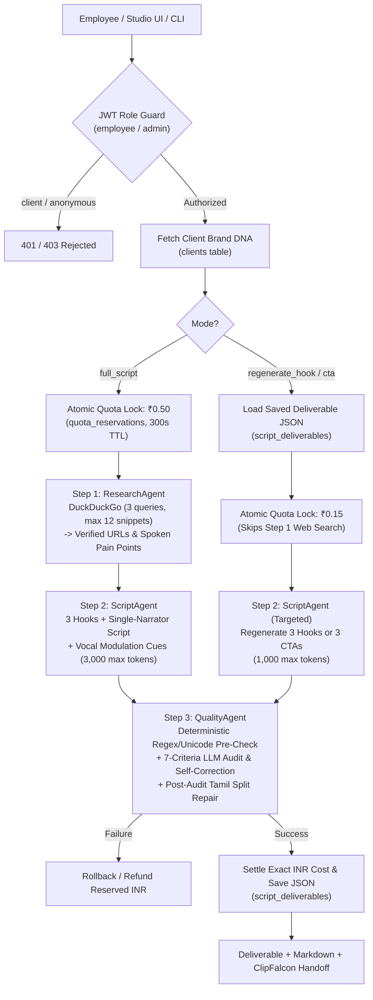

# 🦅 ScriptFalcon: Architecture, Implementation Details, AI Stack & Token Optimization

This document explains **how ScriptFalcon works end-to-end**, the **step-by-step implementation**, the **AI models and tools used**, and **how tokens and INR costs are optimized** in the **VG Digital Falcon CRM** integration.

---

## 1. How ScriptFalcon Works (End-to-End Architecture)

ScriptFalcon transforms a topic (plus optional CRM Client Brand DNA) into a **humanized, respectful, single-narrator Tamil or Tanglish short-form video script** (`30s`, `45s`, or `60s`) through a **3-Step Modular Agent Pipeline** wrapped in atomic CRM quota controls.

---

## 2. Step-by-Step Implementation Details

### Step 1: Token, Model & Guardrail Configuration (`src/config.py`, `src/llm.py`)
- **Output Token Buffer (`src/config.py`):**
  - `MAX_OUTPUT_TOKENS = 3000` for full script generation and quality auditing so dense Tamil Unicode text never truncates mid-word.
  - `REGENERATION_MAX_OUTPUT_TOKENS = 1000` for lightweight hook/CTA regeneration.
  - `LLM_TEMPERATURE = 0.4` for balanced hook creativity without breaking JSON structure.
- **Centralized Pricing & Models (`src/config.py`):**
  - Default models: `GEMINI_MODEL = "gemini-3.5-flash-lite"`, `OPENAI_MODEL = "gpt-4o-mini"`, `ANTHROPIC_MODEL = "claude-3-5-sonnet-20241022"`.
  - Centralized `USD_TO_INR_RATE = 85.0` and `MODEL_PRICING_USD_PER_1M` table, consumed by `calculate_cost_inr(model_name, input_tokens, output_tokens)`.
  - Budget locks: `FULL_SCRIPT_BUDGET_INR = 0.50`, `REGENERATION_BUDGET_INR = 0.15`, `QUOTA_RESERVATION_TTL_SECONDS = 300`.
- **Single-Source-of-Truth Guardrail Lists (`src/config.py`):**
  - `BANNED_AI_CLICHES` (e.g., `"game-changer"`, `"unlock your potential"`, `"in today's fast-paced world"`, `"dive deep"`, `"delve into"`, and Tamil equivalents).
  - `DISRESPECTFUL_SLANG_BLACKLIST` (`"avan"`, `"ivan"`, `"aval"`, `"ival"`, `"da"`, `"di"`, `"dei"`, `"macha"`, `"machan"`, `"அவன்"`, `"இவன்"`, `"அவள்"`, `"இவள்"`, etc.).
  - `TWO_PERSON_SKIT_MARKERS` (`"person a"`, `"person b"`, `"friend 1"`, `"customer:"`, `"shopkeeper:"`, etc.).
  - `RESPECTFUL_ADDRESS_MARKERS` (`"neenga"`, `"ungalukku"`, `"namma"`, `"நீங்க"`, `"உங்களுக்கு"`, `"நம்ம"`, etc.).
  - `VOCAL_MODULATION_MARKERS` (`"[Pause]"`, `"[Stress]"`, `"[Question tone]"`, `"[Slow down]"`, `"[Curious tone]"`, `"[Direct eye contact]"`).
- **Token & Truncation Tracking (`src/llm.py`):**
  - `LLMClient.generate_json_with_meta()` passes `temperature` and `max_output_tokens`, extracts provider token counts (`usage_metadata` for Gemini, `usage` for Anthropic/OpenAI), computes `cost_inr`, and flags `finish_reason` truncation (`MAX_TOKENS` / `LENGTH`).
  - `LLMClient.generate_json()` preserves backwards compatibility while recording metadata on `self.last_usage`.

---

### Step 2: Humanized Prompt Engineering & Tamil Pacing (`src/prompts.py`, `src/models.py`, `src/agents/`, `src/simulation.py`)
- **Step 1 Prompt (`RESEARCH_SYSTEM_PROMPT` in `src/prompts.py` & `src/agents/research_agent.py`):**
  - Runs 3 live DuckDuckGo queries via `run_research_queries()`, injects Client Brand DNA (if present), extracts 3–5 verified facts mapped to real URLs, and frames 3 audience pain points in everyday spoken terms instead of corporate jargon.
- **Step 2 Prompt (`SCRIPT_SYSTEM_PROMPT` in `src/prompts.py` & `src/agents/script_agent.py`):**
  - Locks **Single-Narrator** delivery addressing the viewer respectfully (`Neenga` / `Ungalukku` / `Namma`).
  - Enforces **short breathable lines** calibrated at **~2.2 words/sec**:
    - `30s`: `60 – 75` spoken words
    - `45s`: `95 – 110` spoken words
    - `60s`: `125 – 145` spoken words
  - Requires inline vocal modulation cues (`[Pause]`, `[Stress]`, `[Curious tone]`, `[Direct eye contact]`, `[Slow down]`, `[Question tone]`).
  - Bans formal *Sen-Tamil* (`செய்யுங்கள்`, `உள்ளதா`) in favor of colloquial spoken Tamil (`பண்ணுங்க`, `இருக்கா`).
- **Tamil-Safe Word Counter (`ScriptDraft.word_count` in `src/models.py`):**
  - Strips bullet numbering (`1.`, `2.`) and inline `[modulation]` tags so stage cues do not inflate spoken duration estimates.
  - Uses Tamil Unicode-aware tokenization (`[\w\u0B80-\u0BFF]+`) so Tamil combining vowel signs (`\u0BBE-\u0BCD`, `\u0BD7`) stay attached to their base letters instead of splitting a single Tamil word into multiple tokens.
- **Offline Humanized Simulation (`src/simulation.py`):**
  - `SimulationProvider` generates respectful, modulation-cued Tamil and Tanglish scripts calibrated to `30s`/`45s`/`60s` word windows when running without external API keys.

---

### Step 3: 7-Criteria Quality Auditor & Tamil Integrity Guardrails (`src/agents/quality_agent.py`)
Expands the quality check from 5 criteria to **7 strict criteria** combining deterministic Python checks + LLM self-correction:
1. `unsupported_claims` — Every factual claim maps to a verified research URL.
2. `repetition` — No duplicated points or filler lines.
3. `weak_cta` — Specific, actionable CTA aligned with the campaign objective.
4. `unnatural_tamil` — Natural colloquial Tamil/Tanglish free of formal *Sen-Tamil*.
5. `duration_fit` — Spoken word count fits the `30s`/`45s`/`60s` calibration window.
6. `respectful_and_cliche_free` — Checked deterministically by `find_banned_cliches()` (including client `forbidden_words`) and `find_disrespectful_slang_and_skits()`.
7. `tamil_integrity_and_modulation` — Checked deterministically by `check_tamil_unicode_integrity()` (detects orphan Tamil combining signs, broken `uyirmei` split spaces, invalid consecutive combining marks, `\ufffd`, and unclosed `[` brackets while allowing valid `்`-ending Tamil words), `repair_tamil_splits()`, and `ScriptDraft.extract_modulation_cues()`.

---

### Step 4: CRM Database Persistence & Atomic Quotas (`sql/schema.sql`, `src/db.py`, `src/pipeline.py`)
- **Database Schema (`sql/schema.sql` & `src/db.py`):**
  - `clients`: Stores `client_id`, `client_name`, `target_audience`, `industry`, `brand_tone`, `forbidden_words` (JSONB/JSON).
  - `client_quotas`: Tracks `balance_inr` and `reserved_inr`.
  - `quota_reservations`: Tracks `reservation_id`, `operation`, `reserved_amount_inr`, `actual_cost_inr`, `status` (`RESERVED`, `SETTLED`, `REFUNDED`, `EXPIRED`), and `expires_at` (`300s` TTL).
  - `script_deliverables`: Persists full structured `deliverable_json`, `model_used`, `input_tokens`, `output_tokens`, `tokens_used`, `cost_inr`, and `parent_deliverable_id`.
- **Dual Backend Support (`CRMDatabase`):**
  - Uses **PostgreSQL** (`psycopg` / `psycopg2` with `SELECT ... FOR UPDATE` row locks) when `DATABASE_URL` starts with `postgresql://` or `postgres://`.
  - Falls back to thread-safe **SQLite** (`BEGIN IMMEDIATE` + `threading.RLock()`) when `DATABASE_URL` is unset or `:memory:`.
- **Pipeline CRM Orchestrator (`TamilReelScriptPipeline.run_for_crm`):**
  1. Injects Client Brand DNA from `clients`.
  2. For `regenerate_hook` / `regenerate_cta`, loads saved state from `script_deliverables` (skipping Step 1 search).
  3. Atomically reserves `₹0.50` (`full_script`) or `₹0.15` (`regenerate_hook` / `regenerate_cta`), cleaning up any expired reservations first.
  4. Settles actual `cost_inr` and persists the deliverable on success; automatically refunds the reservation on any failure.

---

### Step 5: Employee-Only FastAPI Router & ClipFalcon Handoff (`src/auth.py`, `api.py`)
- **Employee-Only JWT Guard (`src/auth.py`):**
  - `create_crm_token()` and `verify_crm_token()` implement HS256 JWT signing and validation with expiration checks.
  - `require_employee_user()` allows `employee` and `admin` roles, rejects `client` role with `403 Forbidden`, and rejects missing/expired tokens with `401 Unauthorized`.
- **Mounted ScriptFalcon CRM Routes (`api.py`):**
  - `POST /api/v1/script-falcon/generate`
  - `POST /api/v1/script-falcon/regenerate-hook`
  - `POST /api/v1/script-falcon/regenerate-cta`
  - `GET /api/v1/script-falcon/history/{client_id}`
  - `POST /api/v1/script-falcon/send-to-clipfalcon` — Builds (and optionally dispatches via `CLIPFALCON_WEBHOOK_URL`) `ClipFalconHandoffPayload` containing `expected_word_count`, `selected_hook`, `full_spoken_script`, `segments`, `on_screen_texts`, `vocal_modulation_cues`, `forbidden_words_checked`, and `audit_passed`.

---

### Step 6: ScriptFalcon Studio UI & Verification (`app.py`, `tests/test_scriptfalcon.py`)
- **Streamlit Studio UI (`app.py`):**
  - Upgraded to **ScriptFalcon Studio** with `Plus Jakarta Sans` + `Noto Sans Tamil` typography, a 4-card KPI strip, Hook Lab cards, inline vocal modulation cue badges, a dark **Teleprompter** toggle, 7-Criteria Audit grid, optional **CRM Client Mode**, and **ClipFalcon Audit Payload** export.
- **Automated Tests (`tests/test_scriptfalcon.py` & `tests/test_pipeline.py`):**
  - **18 unit & integration tests** covering config hardening, Tamil word counting, Tamil Unicode split detection/repair, 7-criteria flagging & self-correction, Brand DNA injection, atomic quota TTL/rollback/concurrency, employee-only JWT guard, CRM endpoints, ClipFalcon handoff, and `30s`/`45s`/`60s` calibration.

---

## 3. What AI Models Are Used

| Role | Provider / SDK | Configured Model(s) | Purpose |
| :--- | :--- | :--- | :--- |
| **Primary Fast / Cost-Optimized Model** | Google Gemini (`google-genai`) | `gemini-3.5-flash-lite` (default), with automatic failover across `gemini-3.8-flash`, `gemini-3.6-flash`, `gemini-3.1-flash-lite`, `gemini-2.5-flash`, `gemini-2.5-flash-lite` | Executes Step 1 research synthesis, Step 2 humanized scriptwriting, and Step 3 quality auditing at low latency and INR cost |
| **Alternative OpenAI / Groq Endpoint** | OpenAI (`openai`) | `gpt-4o-mini` (default), `gpt-4o`, or Groq-compatible endpoints via `OPENAI_BASE_URL` | Drop-in alternative JSON-mode LLM provider |
| **Alternative Anthropic Endpoint** | Anthropic (`anthropic`) | `claude-3-5-sonnet-20241022` | High-reasoning alternative provider |
| **Offline Deterministic Fallback** | Local Python (`SimulationProvider`) | `"simulation"` | Enables zero-cost offline testing, local demos, and CI verification without API keys |

---

## 4. What Tools & Technologies Are Used

| Category | Tool / Library | Where Used | Role in System |
| :--- | :--- | :--- | :--- |
| **Live Web Search** | `duckduckgo-search` / `ddgs` | `src/search_tool.py` | Runs 3–6 live queries per topic and enforces zero-hallucination URLs |
| **Schema & Validation** | `pydantic` (`>=2.0.0`) | `src/models.py`, `api.py` | Enforces input bounds, reactive `@computed_field` word counting, and JSON serialization |
| **REST API & ASGI** | `fastapi`, `uvicorn`, `requests` | `api.py`, `main.py` | Exposes standalone & employee-only `/api/v1/script-falcon/*` routes and ClipFalcon webhook dispatch |
| **Database** | PostgreSQL (`psycopg[binary]`) & `sqlite3` | `sql/schema.sql`, `src/db.py` | Persists Brand DNA, atomic INR quota reservations, and script deliverables |
| **Authentication** | Python stdlib (`hmac`, `hashlib`, `base64`) | `src/auth.py` | Zero-dependency HS256 JWT signing/verification and `employee`/`admin` RBAC |
| **Deterministic Guardrails** | Python `re` + Unicode ranges (`\u0B80-\u0BFF`) | `src/agents/quality_agent.py` | Scans AI clichés, disrespectful slang, 2-person skits, and Tamil `uyirmei` integrity |
| **Studio Web UI** | `streamlit` | `app.py` | Interactive creator studio, teleprompter mode, CRM client selector, and exports |
| **Testing & Config** | `pytest`, `python-dotenv`, `rich` | `tests/`, `src/config.py` | Offline test suite, `.env` secret management, and CLI formatting |

---

## 5. Token Optimization & Cost Breakdown

### Measured Token Usage & Cost (Observed in Pipeline Verification)
Measured on the 30-second Spoken Tamil pipeline using the codebase's token estimator and `gemini-3.5-flash-lite` pricing (`$0.075` / 1M input, `$0.30` / 1M output at `₹85 / USD`):

| Execution Mode | Input Tokens | Output Tokens | Total Tokens | Estimated Cost (INR) | Token Savings vs Full Run |
| :--- | :---: | :---: | :---: | :---: | :---: |
| **`full_script` (30s)** | 3,047 | 1,163 | **4,210** | **₹0.0490** (budget lock: ₹0.50) | Baseline (Steps 1 + 2 + 3) |
| **`regenerate_hook`** | 1,693 | 702 | **2,395** | **₹0.0287** (budget lock: ₹0.15) | **43.1% fewer tokens** (1,815 saved) |
| **`regenerate_cta`** | 1,498 | 728 | **2,226** | **₹0.0281** (budget lock: ₹0.15) | **47.1% fewer tokens** (1,984 saved) |

*(Note: Live LLM runs on Gemini/OpenAI may vary slightly depending on topic length, search snippet volume, and whether Step 3 applies script revisions.)*

### 6 Token & Cost Optimization Mechanisms Built Into Code
1. **Search-Free Hook & CTA Regeneration (`src/pipeline.py`, `src/db.py`):**
   - Persisting `FullDeliverable` JSON in `script_deliverables` lets `regenerate_hook` and `regenerate_cta` reload verified research and script body from PostgreSQL/SQLite. This **eliminates the entire Step 1 web search + Research LLM call** and outputs only 3 hooks or 3 CTAs, cutting token usage by **~43%–47%**.
2. **Search Query & Snippet Capping (`src/agents/research_agent.py`):**
   - Queries are trimmed to 8 core words (`_generate_search_queries`), URLs are deduplicated, and Step 1 context is capped at `raw_results[:12]` short snippets instead of passing full web pages into the prompt.
3. **Deterministic Pre-Checks & Python Self-Repair (`src/agents/quality_agent.py`):**
   - Regex and Unicode scans (`find_banned_cliches`, `find_disrespectful_slang_and_skits`, `check_tamil_unicode_integrity`) run locally at **0 tokens** before Step 3. Detected issues are passed as concrete flags so the LLM fixes everything in **a single Step 3 call** instead of multi-turn retry loops, while `repair_tamil_splits()` fixes spaced `uyirmei` marks deterministically in Python.
4. **Tiered Output Token Caps (`src/config.py`):**
   - Full scripts use `MAX_OUTPUT_TOKENS = 3000` (preventing costly retry runs caused by mid-word Tamil truncation), while hook/CTA regenerations are bounded to `REGENERATION_MAX_OUTPUT_TOKENS = 1000`.
5. **Lightweight Default Model Tier (`src/config.py`):**
   - Defaults to `gemini-3.5-flash-lite` / `gpt-4o-mini` rather than flagship models (`gpt-4o` or `claude-3-5-sonnet`), keeping a full 3-step script well under the `₹0.50` CRM cap.
6. **Atomic Reserve-and-Settle Cost Control (`src/db.py`):**
   - Locks only `₹0.50` / `₹0.15` upfront with a `300s` TTL, settles only the **exact actual `cost_inr`** computed from provider token usage after Step 3, and **refunds 100%** on failure.
